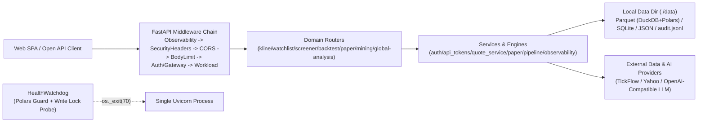
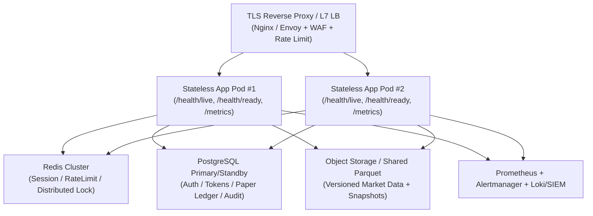

# 02 架构评估与演进设计（Architecture Review）

## 1. 当前架构视图（基于代码核实）

### 优势
- **安全边界较完整**：`main.py` 具备清晰的中外层中间件顺序、CSRF 同源校验、双通道认证（Cookie Session + Scoped Bearer Token）、SSRF 防护（`safe_http.py`）与 Tier A OpenAPI 契约测试（69 条稳定路由）。
- **数据层读写优化明确**：采用 DuckDB + Polars 内存缓存与 `polars_guard` 并发闸，配合 `HealthWatchdog` 对历史 Polars 死锁形态进行兜底自愈。
- **二次开发隔离良好**：通过 `app/custom/` 与 `src/custom/` 实现扩展与核心主干解耦。

### 核心架构缺陷与瓶颈
1. **单点进程与本地状态耦合（`ARC-SINGLE-NODE-001`）**：
   - 会话表、限流器、Prometheus 指标、行情内存缓存均位于单进程内存；Parquet/SQLite/JSON 文件位于本地磁盘。
   - 任何单机宕机、OOM 或 `HealthWatchdog` 触发 `os._exit(70)` 均会导致全站短暂中断（RTO 取决于宿主机 supervisor 重启与 DuckDB 视图预热耗时）。
2. **核心交易与模拟盘链路边界**：
   - 候选核心链路（**待业务确认**）：
     1. 认证与令牌生命周期（`/api/auth/*`, `/api/settings/api-tokens*`）
     2. 行情/日K/分钟K采集与指标管道（`/api/kline/*`, `/api/pipeline/*`）
     3. 模拟盘下单/撤单/持仓对账（`/api/paper/*`, `app/strategy/paper.py`）
     4. 策略筛选与回测挖掘（`/api/screener/*`, `/api/backtest/*`, `/api/mining/*`）
     5. 配置备份导入导出（`/api/config-backup/*`）
   - 模拟盘目前采用本地文件锁 + `fsync` 原子写（已在 M2 加固），但缺乏独立账务流水不可变存储与定时盘后持仓/资金自动对账作业。
3. **前端包体过大**：`index-*.js` (909 kB) 与 `echarts-*.js` (822 kB) 未进一步按路由拆包，影响弱网首屏体验。

---

## 2. 目标架构演进路线（面向金融级高可用设计目标）

### 关键架构决策记录（ADR 摘要）
- **ADR-A1（最小侵入可观测性落地，本次已实现 `VERIFIED`）**：不引入重量级外部 Agent，先在进程内实现标准化 `/health/live`、`/health/ready`、`/metrics`、`X-Request-ID` 与脱敏 `audit.jsonl`，为后续接入 Prometheus/SIEM 奠定统一契约。
- **ADR-A2（受管异步后台任务，本次已实现 `VERIFIED`）**：所有 API 触发的异步长任务统一经 `spawn_background_task()` 注册强引用与异常回调，杜绝 `RUF006` 静默丢失。
- **ADR-A3（多活状态外置，下一阶段规划 `BLOCKED`）**：若业务明确要求 `99.99%` 可用性，需将认证会话、API 限流与模拟盘账本迁移至外部高可用数据库/Redis，并将只读行情湖仓与计算节点分离。
